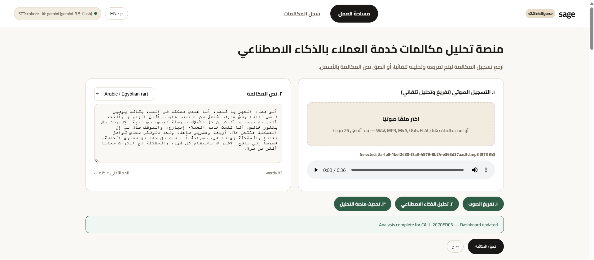
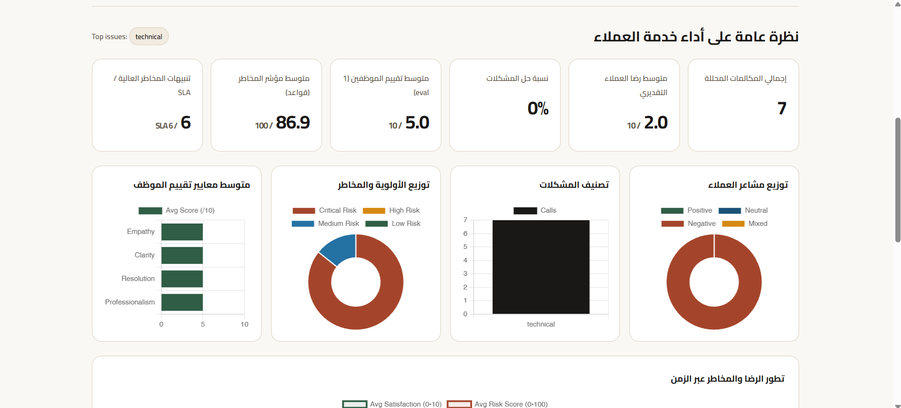
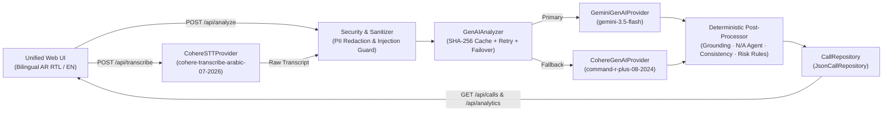
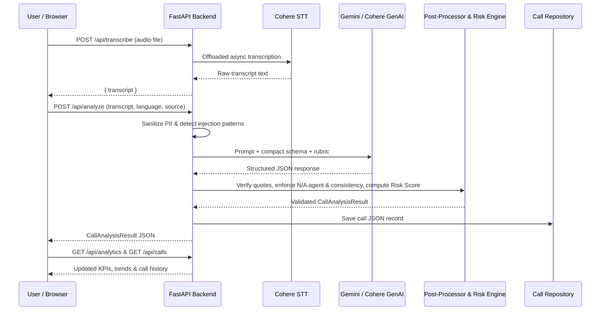

# Sage v2.0 — Customer Support Intelligence Platform


An end-to-end **Speech-to-Text (STT) and Generative AI Customer Support Intelligence Platform** built with FastAPI and Vanilla ES Modules. Sage transcribes customer support call recordings (with calibration for Egyptian Arabic, Modern Standard Arabic, and English), produces evidence-grounded structured JSON call analyses, computes an explainable rule-based Customer Risk Score, and surfaces aggregated performance metrics in a bilingual management dashboard.

---

## Table of Contents

- [Screenshots and Live Demo](#screenshots-and-live-demo)
- [Key Features and Capabilities](#key-features-and-capabilities)
- [Technology Stack and AI Providers](#technology-stack-and-ai-providers)
- [System Architecture and Analysis Workflow](#system-architecture-and-analysis-workflow)
- [Project Folder Structure](#project-folder-structure)
- [Installation and Setup](#installation-and-setup)
- [Environment Variables Configuration](#environment-variables-configuration)
- [Usage](#usage)
- [Testing and Evaluation](#testing-and-evaluation)
- [Future Improvements](#future-improvements)

---

## Screenshots and Live Demo

- **Live Demo:** `<Add deployed Vercel / hosting URL here>`

### Unified Upload, Transcription & AI Pipeline

Audio upload or direct transcript entry with automatic Cohere STT transcription, real-time 3-stage pipeline progress, and bilingual Arabic (`RTL`) / English (`LTR`) layout:



### Aggregated Analytics & Performance Dashboard

Six real-time KPI cards, 4 side-by-side distribution/rubric charts, and daily satisfaction vs. risk trends:



---

## Key Features and Capabilities

- **Speech-to-Text Transcription:** Asynchronous audio upload pipeline supporting `WAV`, `MP3`, `M4A`, `MPEG`, `MPGA`, `OGG`, `FLAC`, and `WEBM` (up to 25 MB locally, 4.5 MB on serverless deployments) with MIME inference, timeout protection, and transient retries.
- **Provider-Agnostic GenAI Analysis:** Primary analysis via Google Gemini (`gemini-3.5-flash`) using native `response_schema` JSON outputs, with automatic failover to Cohere (`command-r-plus-08-2024`) when `GENAI_PROVIDER=auto`, plus SHA-256 exact-transcript response caching.
- **Evidence Grounding and Anti-Hallucination Guardrails:**
  - Deterministic post-processor (`postprocessor.py`) normalizes Arabic/English text and verifies quoted evidence against the source transcript, dropping ungrounded quotes and lowering confidence scores automatically.
  - Strictly enforces `N/A` (`null`) across all agent evaluation dimensions whenever no agent speech is present in the transcript, and excludes `N/A` calls from aggregated agent averages.
  - Enforces cross-field consistency across sentiment labels/scores, resolution flags/types, and evidence-backed root causes, while stripping ungrounded speaker timestamps.
- **Advanced Call Intelligence:** Extracts speaker turns, customer sentiment (score, trajectory, emotions, verbatim evidence), problem classification, pain points, evidence-supported root cause, priority with rationale, resolution & escalation status, repeated complaints, missed commitments, and potential SLA violations.
- **Explainable Rule-Based Customer Risk Score:** Deterministic `0–100` risk assessment (`low`, `medium`, `high`, `critical`) with itemized scoring factors rather than opaque probability predictions.
- **Security and Privacy Controls:** Masks payment card PANs, CVVs, national IDs, and email addresses prior to external LLM calls, sandboxes transcripts inside `<UNTRUSTED_TRANSCRIPT>` delimiters with injection detection, and redacts API secrets from error responses.
- **Unified Bilingual Workspace & Dashboard:** Single-page interface supporting English (`LTR`) and Arabic (`RTL`) with real-time pipeline status, 6 KPI cards, 5 Chart.js visualizations (sentiment, category, risk/priority, agent rubric averages, and daily trends), transcript evidence highlighting, advanced search/filtering/sorting, and **JSON**, **UTF-8 BOM CSV**, and **print-styled PDF** exports.

---

## Technology Stack and AI Providers

| Layer | Technology / Provider | Role |
|---|---|---|
| **Web Framework** | FastAPI + Uvicorn | Async REST API, static asset serving, OpenAPI docs |
| **Validation & Config** | Pydantic v2, Pydantic-Settings, PyYAML | Strict JSON schemas, `.env` and `models_config.yaml` loading |
| **Speech-to-Text** | Cohere Transcribe (`cohere-transcribe-arabic-07-2026`) | Arabic-optimized audio transcription via `STTProvider` ABC |
| **Generative AI (Primary)** | Google Gemini (`gemini-3.5-flash` via `google-genai`) | Native schema-enforced transcript intelligence |
| **Generative AI (Fallback)** | Cohere (`command-r-plus-08-2024` via `cohere`) | JSON-mode failover and benchmark comparison |
| **Frontend** | Vanilla JS (ES Modules), HTML5, CSS3, Chart.js 4 | Bilingual (`AR` RTL / `EN` LTR) workspace and analytics UI |
| **Storage** | JSON file store (`JsonCallRepository`) | File-per-call persistence (`data/calls/` or `/tmp/sage_calls` on Vercel) |
| **Testing & Benchmarks** | Pytest, `pytest-asyncio`, `httpx`, `jiwer`, `edge-tts` | Unit tests, live Egyptian Arabic E2E suite, WER/CER & LLM benchmarks |

---

## System Architecture and Analysis Workflow

### System Architecture



### Call Processing Pipeline



---

## Project Folder Structure

```text
.
├── api/
│   └── index.py                         # Vercel serverless FastAPI entrypoint
├── archive/                             # Archived v1.0 Keras ANN notebooks, models & metrics
├── backend/
│   ├── config.py                        # Pydantic settings (.env + Vercel /tmp path handling)
│   ├── main.py                          # FastAPI app, CORS, health & provider wiring
│   ├── routers/
│   │   ├── analysis.py                  # POST /api/analyze
│   │   ├── analytics.py                 # GET /api/analytics (N/A-excluded averages & trends)
│   │   ├── calls.py                     # GET /api/calls, GET/DELETE /api/calls/{call_id}
│   │   └── transcription.py             # POST /api/transcribe
│   ├── schemas/
│   │   └── call_analysis.py             # Pydantic v2 schemas (CallAnalysisResult, RiskAssessment)
│   └── services/
│       ├── call_repository.py           # CallRepository ABC + JsonCallRepository (search/filter/sort)
│       ├── model_config.py              # YAML loader for models_config.yaml
│       ├── security.py                  # PII redaction, prompt-injection defense, secret masking
│       ├── stt/                         # STTProvider ABC & CohereSTTProvider
│       └── genai/
│           ├── analyzer.py              # Orchestrator (cache, retry, failover)
│           ├── cohere_genai.py          # CohereGenAIProvider
│           ├── gemini_genai.py          # GeminiGenAIProvider
│           ├── interface.py             # GenAIProvider ABC & error types
│           ├── postprocessor.py         # Grounding, consistency, N/A agent & Risk Score
│           └── prompts/                 # System prompt templates & compact schema builder
├── benchmarks/
│   ├── benchmark_config.yaml            # Provider comparison configuration
│   ├── run_benchmark.py                 # LLM accuracy, validity & latency benchmark runner
│   ├── stt_benchmark.py                 # WER / CER evaluator using jiwer
│   └── data/test_calls.json             # Synthetic benchmark dataset
├── data/calls/                          # Persisted call analysis JSON records (gitignored)
├── docs/
│   ├── platform-roadmap.md              # Architecture & transformation roadmap
│   └── screenshots/                     # README screenshots (1.png, 2.png)
├── frontend/
│   ├── index.html                       # Unified SPA shell
│   ├── app.js                           # Client router, language toggle & health status
│   ├── components/                      # escape.js, i18n.js, score-bar.js, sentiment-chip.js
│   ├── styles/                          # main.css, dashboard.css, report.css (RTL & print PDF)
│   └── views/                           # upload.js, analytics.js, call-detail.js, call-history.js
├── results/benchmarks/                  # Generated benchmark outputs
├── tests/
│   ├── integration/test_egyptian_e2e.py # Live Egyptian Arabic audio-to-analytics E2E suite
│   └── test_*.py                        # Unit and API test suite (37 tests)
├── .env.example                         # Environment variable template
├── .gitignore
├── .vercelignore
├── models_config.yaml                   # Provider defaults and agent rubric weights
├── pytest.ini
├── requirements.txt
├── vercel.json
└── README.md
```

---

## Installation and Setup

### Prerequisites

- Python `3.11+` (tested on Python `3.13.3`)
- API key(s) for Cohere (STT and optional GenAI fallback) and/or Google Gemini (primary GenAI)

### Local Installation

```bash
# 1. Clone the repository
git clone <your-repository-url>
cd <repository-folder>

# 2. Create and activate a virtual environment
python -m venv .venv
# Windows (PowerShell)
.\.venv\Scripts\Activate.ps1
# macOS / Linux
source .venv/bin/activate

# 3. Install dependencies
pip install -r requirements.txt

# 4. Create your local environment file
cp .env.example .env
```

---

## Environment Variables Configuration

Copy [`.env.example`](.env.example) to `.env` and populate your API keys locally. Never commit `.env` or hardcode secrets in source code.

| Variable | Default | Description |
|---|---|---|
| `COHERE_API_KEY` | `""` | Required for Cohere STT and Cohere GenAI fallback |
| `GEMINI_API_KEY` | `""` | Required for Google Gemini GenAI analysis |
| `GENAI_PROVIDER` | `auto` | `auto` (prefers Gemini when `GEMINI_API_KEY` is set, else Cohere), `gemini`, or `cohere` |
| `GEMINI_MODEL` | `gemini-3.5-flash` | Gemini model used by `GeminiGenAIProvider` |
| `COHERE_GENAI_MODEL` | `command-r-plus-08-2024` | Cohere model used by `CohereGenAIProvider` |
| `GENAI_MODEL` | `""` | Optional explicit override for the active GenAI model |
| `STT_PROVIDER` | `cohere` | Active STT provider (`cohere`) |
| `STT_MODEL` | `cohere-transcribe-arabic-07-2026` | Cohere Transcribe model identifier |
| `STT_LANGUAGE` | `ar` | ISO-639-1 audio language hint passed to STT |
| `BACKEND_PORT` | `8000` | Port for Uvicorn |
| `CORS_ORIGINS` | `http://localhost:5500,...` | Comma-separated allowed browser origins |
| `MAX_TRANSCRIPT_CHARS` | `50000` | Maximum allowed transcript length per request |
| `ANALYSIS_TIMEOUT_SECONDS` | `60` | Timeout in seconds for STT and GenAI calls |
| `DEFAULT_LANGUAGE` | `ar` | Default language hint (`ar`, `en`, `auto`) |
| `INTEGRATION_TESTS` | `false` | Set `true` to run live external API E2E tests |

Model parameters and agent evaluation rubric weights can also be adjusted in [`models_config.yaml`](models_config.yaml).

---

## Usage

### Running Locally

```bash
uvicorn backend.main:app --reload --port 8000
```

- **Workspace & Dashboard:** `http://127.0.0.1:8000`
- **Interactive OpenAPI Docs:** `http://127.0.0.1:8000/docs`
- **Health Check:** `GET http://127.0.0.1:8000/api/health`

### REST API Reference

| Method | Endpoint | Description |
|---|---|---|
| `POST` | `/api/transcribe` | Upload multipart audio (`file`) to obtain `{ "transcript": "..." }` |
| `POST` | `/api/analyze` | Analyze transcript JSON and persist `CallAnalysisResult` |
| `GET` | `/api/calls` | List stored calls with `search`, `sentiment`, `category`, `priority`, `risk_level`, `resolved`, `sla_violation`, `escalation_required`, `date_from`, `date_to`, `sort_by`, `page`, `limit` |
| `GET` | `/api/calls/{call_id}` | Retrieve a single call record |
| `DELETE` | `/api/calls/{call_id}` | Delete a call record |
| `GET` | `/api/analytics` | Retrieve aggregated KPIs, `N/A`-excluded agent averages, risk stats, and daily trends |
| `GET` | `/api/health` | Check STT/GenAI readiness and active models |

### Deploying to Vercel

1. Push the repository to GitHub (`.env` is ignored via `.gitignore`).
2. Import the repository in Vercel (`vercel.json` routes `/api/*` to `api/index.py` and static assets to `frontend/`).
3. Configure `COHERE_API_KEY`, `GEMINI_API_KEY`, `GENAI_PROVIDER=auto`, and `GEMINI_MODEL=gemini-3.5-flash` in Vercel Environment Variables.
4. Note that on Vercel (`VERCEL=1`), call JSON storage writes to ephemeral `/tmp/sage_calls` and serverless uploads are capped at 4.5 MB.

---

## Testing and Evaluation

### Unit and API Tests

Runs completely offline using deterministic stubs for external providers (`37` tests covering Pydantic schemas, evidence grounding, `N/A` no-agent enforcement, cross-field consistency, rule-based Risk Score, PII redaction, prompt injection defense, repository filters, and API endpoints):

```bash
pytest tests/ -m "not integration" -v
```

### Live Egyptian Arabic End-to-End Integration Test

Synthesizes realistic Egyptian Arabic customer support audio clips with `edge-tts`, runs them through live `POST /api/transcribe` (Cohere STT) and `POST /api/analyze` (Gemini / Cohere), measures normalized WER/CER via `jiwer`, and validates dashboard aggregation including `N/A` voicemail exclusion:

```bash
# PowerShell
$env:INTEGRATION_TESTS="true"
pytest tests/integration/test_egyptian_e2e.py -v -s
```

### Model Benchmarking

Compare configured GenAI providers on schema validity rate, classification accuracy, and `p50`/`p95` latency, or evaluate STT WER/CER:

```bash
python benchmarks/run_benchmark.py
python benchmarks/stt_benchmark.py --reference "<reference text>" --hypothesis "<stt output>"
```

---

## Future Improvements

- **Persistent Relational Storage:** Implement a PostgreSQL or SQLite `CallRepository` backend for durable multi-worker production storage (replacing local JSON / serverless `/tmp` files).
- **Acoustic Speaker Diarization:** Integrate an STT pipeline or diarization pass that emits word-level timestamps (`start_seconds`, `end_seconds`) to unlock synchronized click-to-seek audio playback in the transcript viewer.
- **Additional Model Providers:** Implement `OpenAIGenAIProvider` (`backend/services/genai/openai_genai.py`) matching the `GenAIProvider` interface alongside Gemini and Cohere.
- **Authentication & Multi-Tenancy:** Add API key or JWT authentication and per-team rubric isolation for multi-tenant deployments.
- **Human-in-the-Loop Feedback:** Add a review endpoint (`POST /api/calls/{call_id}/feedback`) to collect analyst corrections into the benchmark dataset.
